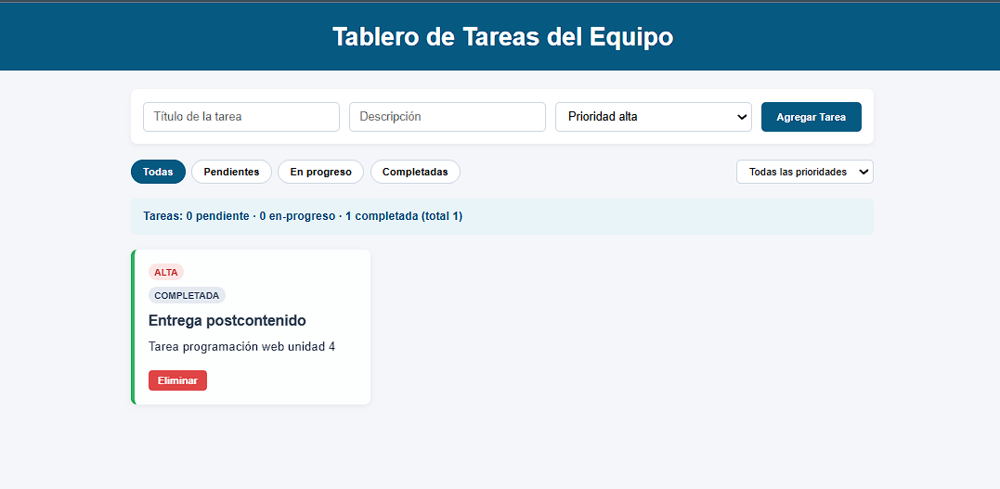
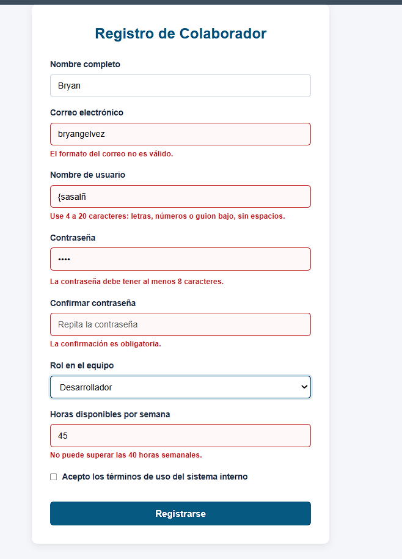
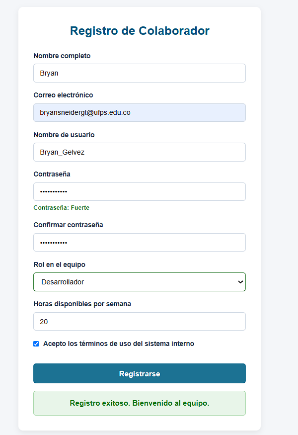

# Post-contenido — Unidad 4: JavaScript Básico

**Estudiante:** Bryan Sneider Gelvez Toloza  
**Carrera:** Ingeniería de Sistemas — 7° Semestre  
**Universidad:** Universidad Francisco de Paula Santander (UFPS)  
**Año:** 2026  

## Descripción
Repositorio del laboratorio de la Unidad 4 de Programación Web — Séptimo Semestre (`Gelvez-post1-u4`). Contiene dos partes: tablero de tareas del equipo con manipulación del DOM y eventos (`parte-1-tablero-tareas/`) y formulario de registro de colaborador con validación manual y Constraint Validation API (`parte-2-formulario-colaborador/`).

## Parte 1 — Tablero de tareas del equipo
Tablero de tareas en JavaScript puro que implementa creación, avance de estado y eliminación (con un único listener delegado que distingue acciones por `data-action`), filtrado combinado por estado y prioridad, un `switch` para la apariencia por prioridad, y estadísticas calculadas con `reduce()` y `for...of`. Ver `parte-1-tablero-tareas/`.

## Parte 2 — Formulario de registro de colaborador
Formulario de registro con validación completa del lado del cliente: campo de usuario validado con `pattern`, campo condicional "equipo a cargo" que solo aplica al rol Líder, campo numérico de horas validado con `rangeUnderflow`/`rangeOverflow`, checkbox de términos validado por `.checked`, control del evento `submit` y un indicador de fortaleza de contraseña en tiempo real. Ver `parte-2-formulario-colaborador/`.

## Decisiones de diseño

### 1. Parte 1 — Generador de ID
Se eligió la **Estrategia A (closure / patrón módulo)** mediante la función `crearGeneradorId()`. Se prefirió sobre una variable `let` global porque encapsula el contador numérico en un ámbito léxico privado, impidiendo que otras funciones del script puedan leerlo, reiniciarlo o corromper la unicidad de los identificadores de las tareas por error.

### 2. Parte 1 — Actualización del DOM al avanzar estado
Se eligió la **Estrategia A (actualización dirigida)** mediante `actualizarEstadoEnDOM()`. Se prefirió sobre reconstruir todo el tablero porque evita destruir y volver a crear nodos del DOM que no sufrieron cambios, optimizando el rendimiento y manteniendo intacto el estado visual de las demás tarjetas y filtros activos.

### 3. Parte 2 — Validación de contraseña
Se eligió la **Estrategia B (validaciones independientes encadenadas)** en `validarPassword()`. Aunque requiere algunas líneas adicionales respecto a una única expresión regular compuesta, permite mostrar mensajes de error específicos indicando exactamente qué requisito hace falta (mayúscula, número o carácter especial), mejorando la experiencia de usuario al corregir el campo.

### 4. Parte 2 — Campo condicional "equipo a cargo"
Se eligió la **Estrategia A (alternar el atributo `required` nativo)** dentro del evento `change` del selector de rol. Al sincronizar `campo.required = esLider`, se delega el control de obligatoriedad directamente a la Constraint Validation API del navegador (`campo.validity.valueMissing`), asegurando coherencia entre el estado del DOM y la lógica de validación.

## Cómo visualizar el proyecto
1. Clonar el repositorio: `git clone https://github.com/BryanGelvez23/Gelvez-post1-u4.git`
2. Abrir la carpeta en Visual Studio Code
3. Clic derecho en `index.html` (de cada parte) → "Open with Live Server"

## Capturas de pantalla

